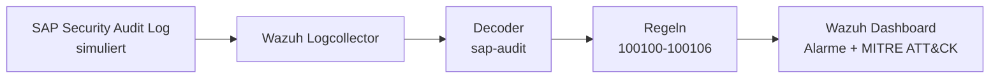
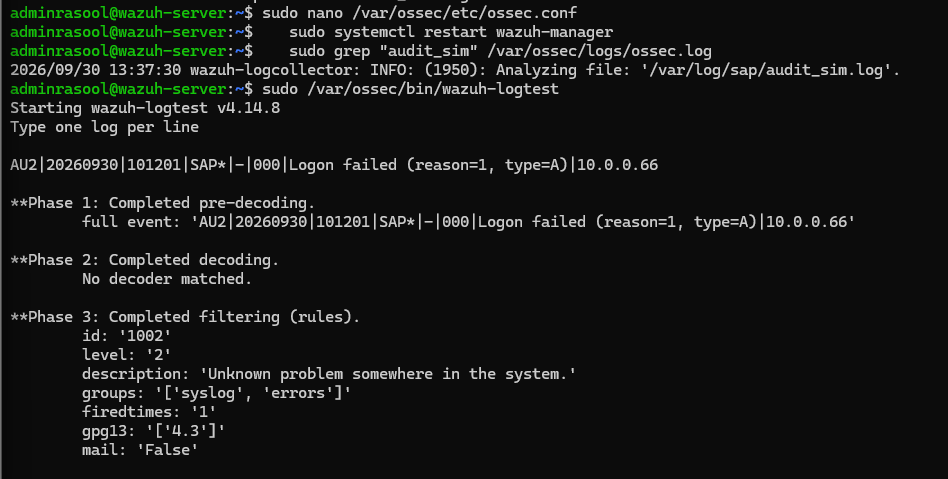
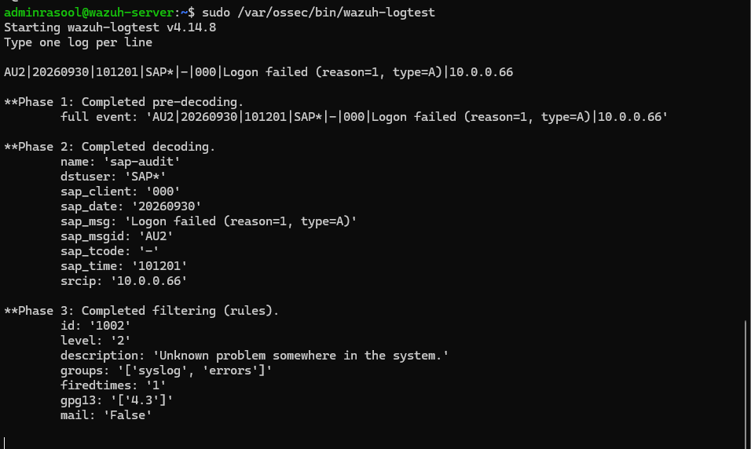
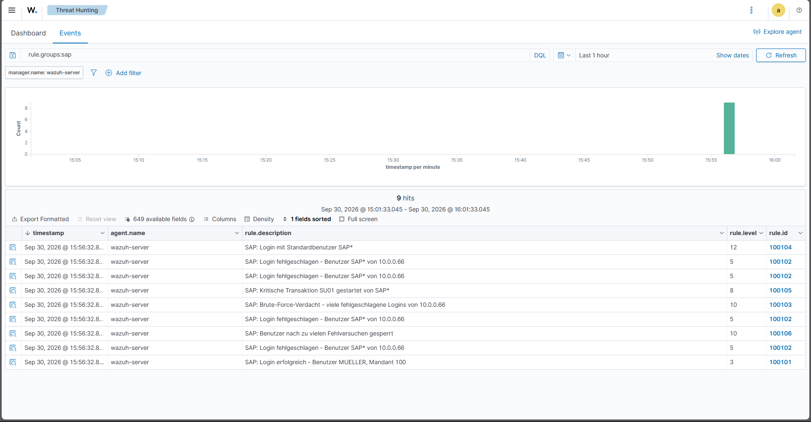
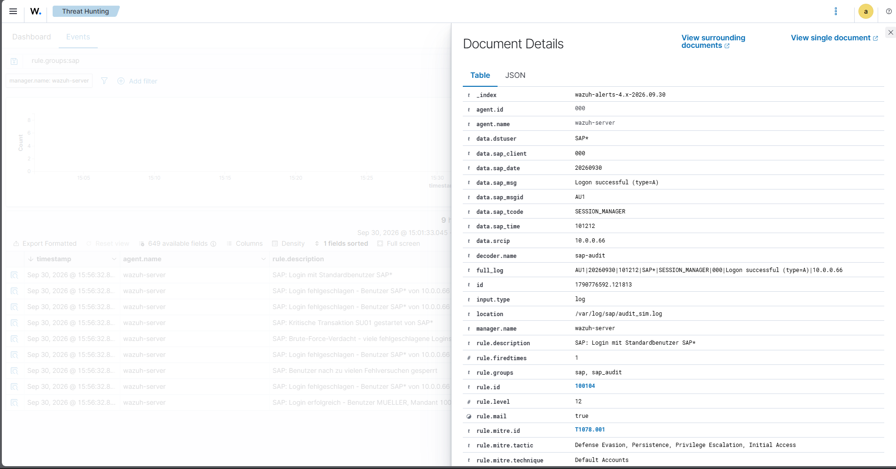

# SAP Security Monitoring mit Wazuh

Erkennung von Angriffen auf SAP-Systeme durch eigene Wazuh-Decoder und -Regeln für das **SAP Security Audit Log**.

Wazuh bringt von Haus aus keine Unterstützung für das SAP-Audit-Log-Format mit. Ohne eigene Regeln bleibt ein Angriff auf ein SAP-System für das SIEM praktisch unsichtbar. Dieses Projekt schließt diese Lücke.

## Architektur



## Erkannte Angriffe

| Regel | Stufe | Erkennt | MITRE ATT&CK |
|---|---|---|---|
| 100102 | 5 | Fehlgeschlagener Login (AU2) | T1110 Brute Force |
| 100103 | 10 | 5 Fehlversuche von derselben IP in 2 Minuten | T1110 Brute Force |
| 100104 | 12 | Login mit Standardbenutzer `SAP*` oder `DDIC` | T1078.001 Default Accounts |
| 100105 | 8 | Start kritischer Transaktionen (`SU01`, `PFCG`, `SE38` …) | – |
| 100106 | 10 | Benutzersperre nach Fehlversuchen (AUM) | – |

Normale Arbeit (z. B. Rechnungsbuchung mit `FB60`) löst bewusst **keinen** Alarm aus, um Fehlalarme zu vermeiden.

## Vorher / Nachher

**Ohne eigenen Decoder:** Wazuh erkennt die SAP-Zeile nicht und greift auf eine generische Regel zurück.



**Mit eigenem Decoder und Regeln:** Die Zeile wird in Felder zerlegt, und der Angriff wird korrekt eingestuft.



## Demo: Angriffsszenario

Das Skript [`scripts/simulate_attack.sh`](scripts/simulate_attack.sh) spielt folgendes Szenario ab:

1. Ein Mitarbeiter arbeitet normal (Login, Rechnungsbuchung)
2. Ein Angreifer versucht fünfmal, sich als `SAP*` anzumelden → **Brute Force erkannt**
3. Der sechste Versuch gelingt → **Login mit Standardbenutzer erkannt**
4. Der Angreifer öffnet die Benutzerverwaltung `SU01` → **kritische Transaktion erkannt**





## Incident Response

Für die wichtigsten Alarme gibt es Playbooks mit konkreten Reaktionsschritten: [playbooks/incident-response.md](playbooks/incident-response.md)

## Projektstruktur

```
wazuh/          Decoder, Regeln und Konfiguration
sample-logs/    Simulierte SAP-Audit-Log-Einträge
scripts/        Skript zur Angriffssimulation
playbooks/      Incident-Response-Playbooks
screenshots/    Screenshots der Ergebnisse
notes/          Lernnotizen
```

## Setup

Getestet mit Ubuntu Server 24.04 LTS und Wazuh 4.14 (All-in-One).

1. Wazuh installieren (siehe [Wazuh Quickstart](https://documentation.wazuh.com/current/quickstart.html))
2. Logdatei anlegen: `sudo mkdir -p /var/log/sap && sudo touch /var/log/sap/audit_sim.log`
3. Inhalt von `wazuh/ossec_localfile.xml` in `/var/ossec/etc/ossec.conf` einfügen
4. Inhalt von `wazuh/sap_decoder.xml` in `/var/ossec/etc/decoders/local_decoder.xml` einfügen
5. Inhalt von `wazuh/sap_rules.xml` in `/var/ossec/etc/rules/local_rules.xml` einfügen
6. Konfiguration prüfen und neu starten: `sudo /var/ossec/bin/wazuh-analysisd -t && sudo systemctl restart wazuh-manager`
7. Angriff simulieren: `bash scripts/simulate_attack.sh`

## Einschränkungen

- **Simulierte Logs:** Es wurde kein echtes SAP-System verwendet. Die Logzeilen orientieren sich an den echten Meldungs-IDs (AU1, AU2, AU3, AUM), das Format ist aber vereinfacht. Im echten Betrieb würde das Audit Log z. B. über einen Agent auf dem SAP-Server oder einen Export angebunden.
- **Begrenzte Regelabdeckung:** Das Projekt deckt ausgewählte Szenarien ab, nicht alle der über 100 Meldungs-IDs des SAP Audit Logs.
- **Schwellwerte:** Die Werte (z. B. 5 Fehlversuche in 2 Minuten) sind Beispielwerte und müssten im echten Betrieb an die Umgebung angepasst werden.

## Was ich gelernt habe

- **Detection Engineering:** Wie man für ein Logformat, das Wazuh nicht kennt, einen eigenen Decoder und eigene Regeln schreibt und sie mit `wazuh-logtest` Schritt für Schritt testet.
- **SAP-Sicherheit:** Dass Standardbenutzer wie `SAP*` ein großes Risiko sind, dass Löschen statt Sperren die Lage sogar verschlimmern kann und dass das Security Audit Log erst über Profilparameter aktiviert werden muss.
- **Troubleshooting:** Probleme systematisch eingrenzen, z. B. ein falsch gespeichertes Passwort durch eine nicht erkannte Shift-Taste in der VM, eine abgestürzte Wazuh-API nach dem Standby und ein Decoder, der wegen Leerzeichen am Zeilenanfang nicht gegriffen hat.
- **SOC-Denken:** Dass nicht jede Aktivität einen Alarm braucht (Fehlalarme vermeiden) und dass ein erfolgreicher Login nach mehreren Fehlversuchen viel kritischer ist als die Fehlversuche allein.

